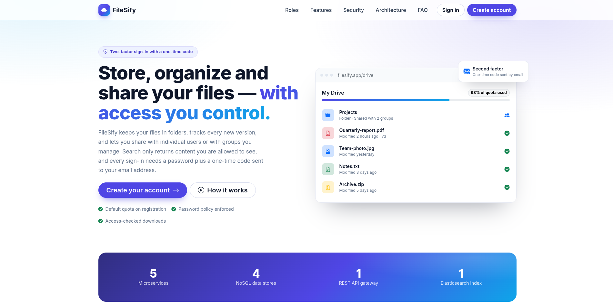
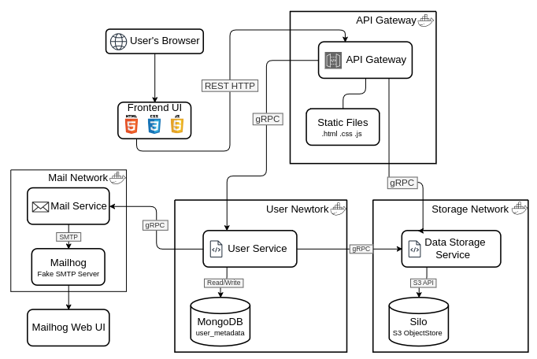

<div align="center">

# ☁️ FileSify 

**A highly scalable, fault-tolerant file storage and sharing platform built with Go & Service-Oriented Architecture.**

[](https://golang.org)
[](https://grpc.io)
[](https://www.docker.com)
[](https://www.mongodb.com)
[](https://silo.pgsty.com/)
[](https://github.com/mailhog/MailHog)


### Frontend
[]()
[]()
[]()
[]()
</div>

---

## 📖 Overview

**FileSify** is a Dropbox-inspired distributed system designed to demonstrate modern microservice architecture. It utilizes **gRPC** for blazing-fast inter-service communication and a **gRPC-Gateway** to expose a RESTful API to a unified web frontend. 

The system guarantees high availability through **fault-tolerant retry loops**, isolated database states, and strict **Docker network segregation**.

---

## 📸 Preview

<div align="center">
  
</div>

---

## 🏗️ System Architecture

<div align="center">
  
</div>

### 🧩 Microservices Breakdown

| Service | Responsibility | Tech Stack | Port |
| :--- | :--- | :--- | :--- |
| 🛡️ **API Gateway** | REST to gRPC translation, serves static frontend files. | Go, gRPC-Gateway | `8080` |
| 👤 **User Service** | Auth, JWT generation, 2FA, user profiles. | Go, MongoDB | `8082` |
| 🗄️ **Storage Service** | File & folder metadata, infinite nested directory logic. | Go, S3 API (Silo) | `8083` |
| ✉️ **Mail Service** | Dispatching OTPs and Magic Links. | Go, SMTP | `8085` |

### 🌐 Network Topology
To ensure zero-trust security, the services are segmented into three distinct Docker networks:
*   🟢 **`user-network`**: Isolates User DB, User Service, and Mail Service.
*   🟡 **`storage-network`**: Isolates the Storage Service and the MinIO/Silo object store.
*   🔵 **`mail-network`**: Isolates the Mail Service and the MailHog SMTP server.

---

## 🚀 Getting Started

### 📋 Prerequisites
Ensure you have the following installed on your machine:
*   [Docker & Docker Compose](https://docs.docker.com/get-docker/)
*   [Go (1.27+)](https://go.dev/dl/)
*   [Protocol Buffers Compiler](https://grpc.io/docs/protoc-installation/)

### ⚙️ Environment Setup
Create the necessary `.env` files in your `backend` directory before launching the stack.

<details>
<summary><b>Click to view backend/.env configuration</b></summary>

```env
# --- Object Storage (Silo/MinIO) ---
MINIO_ROOT_USER=silo-admin
MINIO_ROOT_PASSWORD=change-me
SILO_ENDPOINT=silo:9000
SILO_CONSOLE_PORT=9001
STORAGE_PORT=8083

# --- Gateway & User Service ---
GATEWAY_PORT=8080
USER_SERVICE_PORT=8082
USER_DB_USERNAME=user_admin
USER_DB_PASS=user_pass